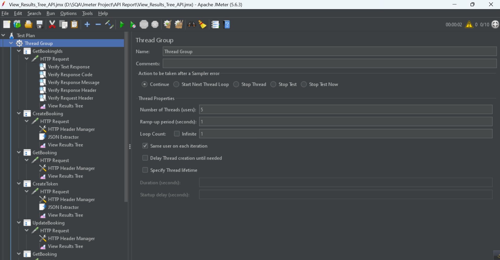
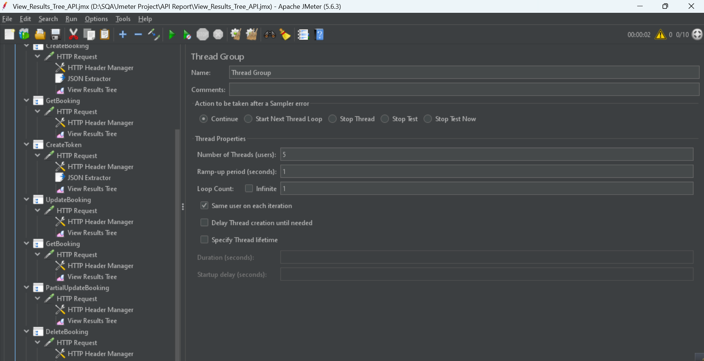
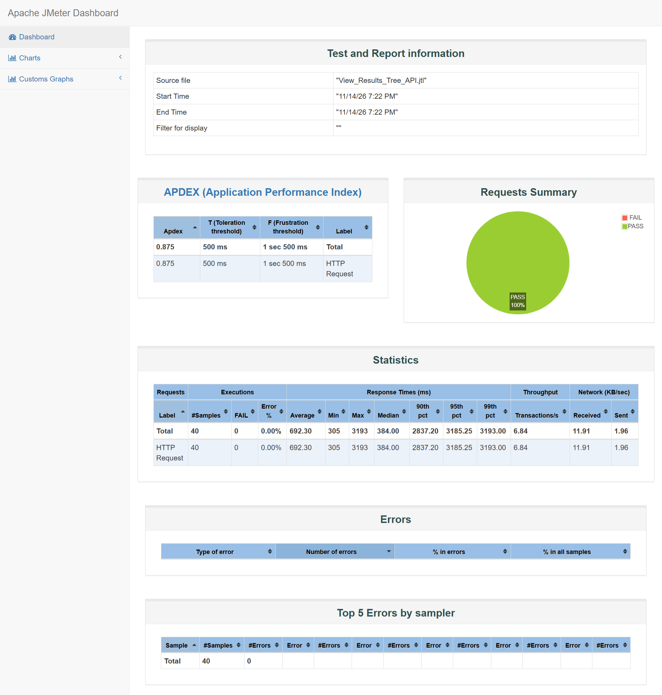

# API Performance Testing with Apache JMeter

A JMeter test plan that exercises the full CRUD lifecycle of the public [Restful-Booker](https://restful-booker.herokuapp.com) API, along with the HTML dashboard report generated from a test run.

## Overview

The test plan sends requests to every main endpoint of the Restful-Booker API, validates the responses with assertions, and records results in a **View Results Tree** listener. After the run, an Apache JMeter HTML Dashboard was generated for easy analysis of response times, throughput, APDEX and errors.

| Item | Details |
|------|---------|
| Tool | Apache JMeter 5.6.3 |
| Target API | `https://restful-booker.herokuapp.com` |
| Test plan | `View_Results_Tree_API.jmx` |
| Report | `index.html` (JMeter HTML Dashboard) |

## Test Scenario

**Thread Group configuration**

| Setting | Value |
|---------|-------|
| Threads (users) | 5 |
| Ramp-up period | 1 second |
| Loop count | 1 |
| On sample error | Continue |

**Requests (executed in order)**

| # | Sampler | Method | Endpoint | Purpose |
|---|---------|--------|----------|---------|
| 1 | GetBookingIds | GET | `/booking` | Fetch all booking IDs |
| 2 | CreateBooking | POST | `/booking` | Create a new booking (JSON body); booking ID is extracted via a JSON Extractor |
| 3 | GetBooking | GET | `/booking/${id}` | Fetch the booking just created |
| 4 | CreateToken | POST | `/auth` | Generate an auth token for protected endpoints |
| 5 | UpdateBooking | PUT | `/booking/${id}` | Full update (uses `token` cookie / `Authorization` header) |
| 6 | PartialUpdateBooking | PATCH | `/booking/${id}` | Partial update |
| 7 | DeleteBooking | DELETE | `/booking/${id}` | Delete the booking |

**Assertions (GetBookingIds)**

- Response body contains `bookingid`
- Response code is `200`
- Response message is `OK`
- Response header contains `Content-Type: application/json`
- Request header contains `Connection: keep-alive`

**Other elements:** HTTP Header Manager (`Content-Type`, `Accept`), JSON Extractor (dynamic `id` / `token` correlation), View Results Tree listener.

## Screenshots

## JMeter Test Plan




### HTML Report Dashboard


## Repository Structure

```

├── View_Results_Tree_API.html/   
├── index.html                  # HTML dashboard report 
├── content/                    # Dashboard CSS, JS and chart pages
└── sbadmin2-1.0.7/             # Dashboard theme assets
```

> `content/` and `sbadmin2-1.0.7/` are generated by JMeter alongside `index.html`.

## Prerequisites

- [Java](https://www.oracle.com/java/technologies/downloads/) 8 or higher
- [Apache JMeter 5.6.3](https://jmeter.apache.org/download_jmeter.cgi) (or newer)
- Internet access (the target API is public)

## How to Run

### GUI mode (for building / debugging)

1. Launch JMeter (`bin/jmeter.bat` on Windows, `bin/jmeter.sh` on Linux/macOS).
2. Open `View_Results_Tree_API.jmx` via **File → Open**.
3. Click the green **Start** button and inspect results in **View Results Tree**.

### Non-GUI mode (recommended for actual test runs)

```bash
jmeter -n -t View_Results_Tree_API.jmx -l results.jtl -e -o report/
```

| Flag | Meaning |
|------|---------|
| `-n` | Non-GUI mode |
| `-t` | Test plan file |
| `-l` | Raw results file (`.jtl`) |
| `-e -o` | Generate the HTML dashboard into the `report/` folder (must be empty or non-existent) |

## Viewing the Report

Open `index.html` in any modern browser. The dashboard includes:

- **Test and Report information** – source file, start/end time
- **APDEX** – application performance index
- **Requests Summary** – pass/fail ratio
- **Statistics** – per-request response time, percentiles, throughput, error %
- **Errors** and **Top 5 Errors by Sampler**
- **Charts** – Over Time, Throughput, Response Times

The included report was generated from a run on **14 Nov 2026**.

## Notes

- The Restful-Booker API is a shared public sandbox; occasional slowness or data resets are expected.
- Keep thread counts low when testing against public services.
- The auth credentials used in the `CreateToken` request are the publicly documented sandbox credentials for Restful-Booker.

## Resources

- [Apache JMeter Documentation](https://jmeter.apache.org/usermanual/index.html)
- [Restful-Booker API Docs](https://restful-booker.herokuapp.com/apidoc/index.html)
- [Generating the HTML Dashboard](https://jmeter.apache.org/usermanual/generating-dashboard.html)

## Author

Your Name – [GitHub](https://github.com/meemmahmuda)
